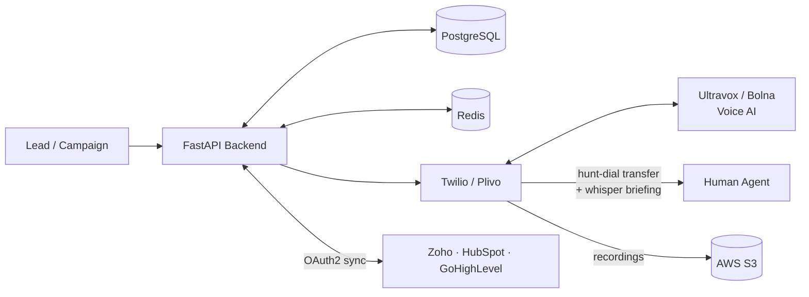

  

  

  
  
  

# Hey, I'm Shashank 👋

I build AI systems that have to work when real people are on the other end, like phone calls that can't drop, CRMs that have to stay in sync, and answers that have to be grounded in real data.

I'm an AI engineer based in Chandigarh, India. I mostly work in Python and FastAPI, and I'm open to remote roles, onsite roles, and freelance projects.

---

## What I do

- **Voice AI:** AI calling agents, telephony, call transfers, recordings
- **RAG and document intelligence:** retrieval systems that answer from your data, not from guesses
- **AI agents:** tool-calling agents and workflows with LangChain and LangGraph
- **Backend engineering:** multi-tenant APIs, OAuth integrations, Postgres, Redis. Before AI I wrote Java and Spring Boot, and that background still shows in how I build.

---

## The project I'm proudest of: a multi-tenant AI voice dialer

I built the backend of a multi-tenant AI voice dialer at [COMPANY NAME or "a SaaS startup in Mohali"], a platform where businesses run AI-powered outbound calls and have the results flow into their CRM. It ran at 1000+ calls a day. (The code is private, so here's what's inside.)

**What it does**
- Places AI-driven calls through Twilio and Plivo, with Ultravox and Bolna as voice providers
- Syncs with **Zoho CRM, HubSpot and GoHighLevel** through OAuth2: bidirectional contact sync, call notes pushed back after each call
- Hands off to a human mid-call with a hunt-dial transfer and a **warm whisper briefing**, so the human knows who they're talking to before they speak
- Stores recordings on S3, with each customer's data kept separate

**Stack:** Python, FastAPI, PostgreSQL, Redis, Twilio, Plivo, Ultravox, Bolna, AWS S3

**What I owned:** the backend, the CRM integrations, the call-transfer flows, and the setup guides customers used to connect their own CRMs.

**The unglamorous lessons:** CRM data is messy (I once chased a phone-number uniqueness bug across two systems), providers fail in different ways, and "works in a demo" and "works on call number 900" are different problems.

[Read the architecture write-up →]([LINK TO YOUR PDF OR BLOG])

---

## Public work you can actually read

- **finance-ai-platform:** an AI finance platform with RAG, deterministic calculations (so the numbers are never hallucinated), SQL analytics, hybrid AI routing, JWT/RBAC and conversational context
- **RAG-System-designed:** [ONE LINE: what makes this one different]
- **paylane-agent:** [ONE LINE: what it does]
- **Ai_Assisted_interview:** [ONE LINE: what it does]

---

## What I'm working on right now

- Going deep on **Google ADK** and comparing it with LangGraph for agent workflows
- Building a LangChain/LangGraph agent that I'll publish here soon
- Writing up my voice AI architecture so others can learn from it

---

## Tools I reach for

  
  
  
  
  
  
  
  
  
  

**AI:** RAG pipelines, embeddings and vector search, prompt and tool-calling design, voice agents (Ultravox, Bolna)
**Backend:** REST, OAuth2, JWT, MySQL, webhooks, Plivo

---

## Work with me

**Hiring?** I'm looking for AI engineer, voice AI, agentic AI or Python backend roles, remote or onsite.
**Have a project?** I take freelance work on voice agents, RAG systems, CRM integrations and AI backends.

📧 [YOUR EMAIL]
💼 [LinkedIn](http://linkedin.com/in/shashankshekhar05)
🌐 [Portfolio](https://shashank-ai-essence.lovable.app)

I usually reply within a day.

